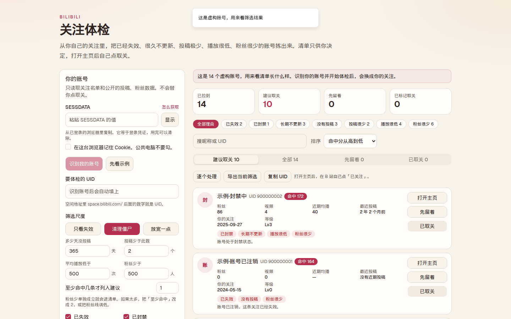

# 关注体检

从你自己的 B 站关注列表里，把这些账号拣成一份清单：

- 已经注销，或空间已经打不开
- 被封禁
- 长期不发视频
- 投稿极少，或主页里已经看不到视频
- 近期视频播放很低
- 粉丝很少

近五千个关注不用一个个点开。工具只列出候选人，**不会替你点取关**。你打开对方主页，在 B 站自己点「已关注」。

这是在浏览器里打开的本地工具。微信小程序带不走你的 B 站登录状态，也查不完几千个关注。



## 功能

- 分页拉取自己的全部关注，中途可以暂停，进度留在这台浏览器。
- 三档预设：「只看失效」「清理僵尸」「放宽一点」。阈值和命中理由都可以改。
- 认证账号和特别关注默认不进建议名单。
- 按理由筛选、搜索昵称或 UID、导出当前筛选的 CSV、复制 UID。
- 「逐个处理」一次看一个人。标成「先留着」或「已取关」只记在本地。
- 没有 Cookie 时可以先看示例数据，熟悉清单再登录。

## 环境

- Node.js 22，或 20.19 及以上
- 一台你自己登录过 B 站的电脑

## 本地运行

```bash
npm ci
npm run dev
```

浏览器打开 [http://127.0.0.1:43127](http://127.0.0.1:43127)。

用 Docker 时同样只在自己的机器上跑：

```bash
docker compose up --build
```

## 怎么用

1. 在电脑浏览器登录 [bilibili.com](https://www.bilibili.com)。
2. 按 F12，打开 Application → Cookies → `https://www.bilibili.com`。
3. 复制 `SESSDATA` 的值，贴到页面里。整段 Cookie 也可以，页面会自己取出这一项。
4. 点「识别我的账号」，确认昵称是你本人。
5. 选筛选尺度，或改天数、投稿数、播放和粉丝线，然后开始体检。
6. 在「建议取关」里打开主页，自己决定取不取。

B 站只让你看全**自己**的关注列表。Cookie 和 UID 不是同一个账号时，大约只能看到 100 个。

五千个关注、并检查近期播放时，均衡速度大约要 20 到 40 分钟。可以暂停。请求会主动放慢，遇到风控会再停一会儿。

「粉丝很少」单独成立就会进清单。人太多的话，把「至少命中」改成 2，或把粉丝线调低。

没有视频、但还在写专栏的人会被标成「没有投稿」。取关前看一眼说明。播放量被 UP 主隐藏时，不会被当成低播放。

## 预设

| 预设 | 会标出 |
| --- | --- |
| 只看失效 | 注销、空间消失、封禁 |
| 清理僵尸 | 上面几项，再加上超过 365 天没投稿、投稿不超过 2 个、近期平均播放低于 500、粉丝少于 500。认证账号和特别关注除外 |
| 放宽一点 | 180 天、8 个投稿、平均播放 5000、粉丝 3000 |

默认是「清理僵尸」。改任意一项之后就变成自定义。

## 隐私

`SESSDATA` 等于登录凭证。

- 默认只放在当前标签页的 sessionStorage。勾选「记住」后才写入 localStorage。
- 服务端只在当次请求里把它转给 B 站，不写进磁盘，也不写进日志。
- 请在自己的电脑上运行。不要把这个页面部署到别人能打开的服务器上，也不要把 Cookie 发给任何人。

仓库不需要任何服务端密钥。

## 开发

```bash
npm test
npm run lint
npm run build
```

筛选规则在 `lib/judge.ts`，对应测试是 `lib/judge.test.ts`。B 站请求在 `lib/bilibili.ts`，页面在 `components/`。

持续集成会在推送到 `main` 和拉取请求上跑测试、lint 和生产构建。

## 许可

[MIT](LICENSE)
